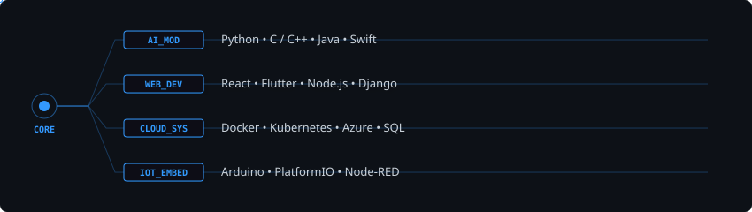
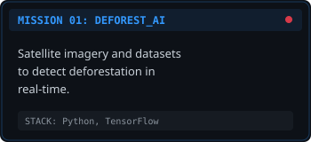
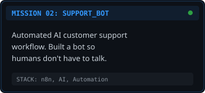

  <h1>Hi, I'm Nathanaël Bousseau 🛰️</h1>

  
   
  
    

  <!-- Remplace ces liens par les tiens -->
  
  

  

  

 

<h3 align="center">Tech Stack</h3>

  

 

<h3 align="center">Active Missions</h3>

  &nbsp;&nbsp;&nbsp;&nbsp;
  

 

  

